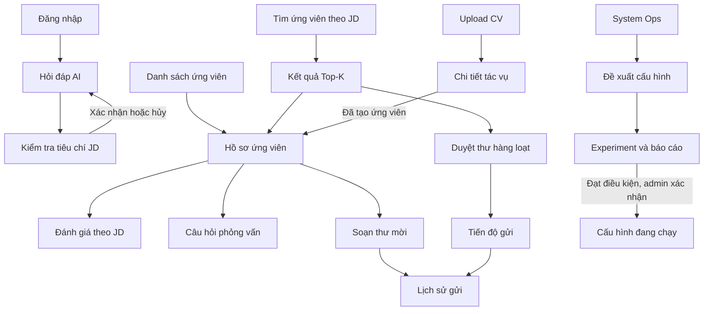
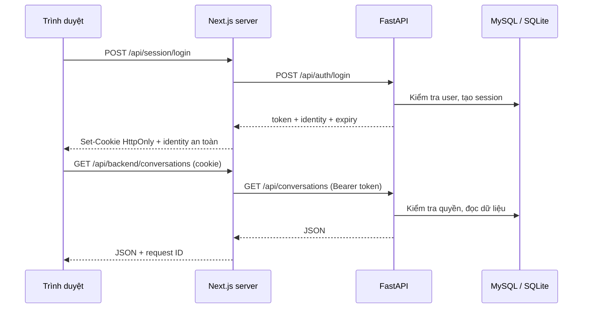
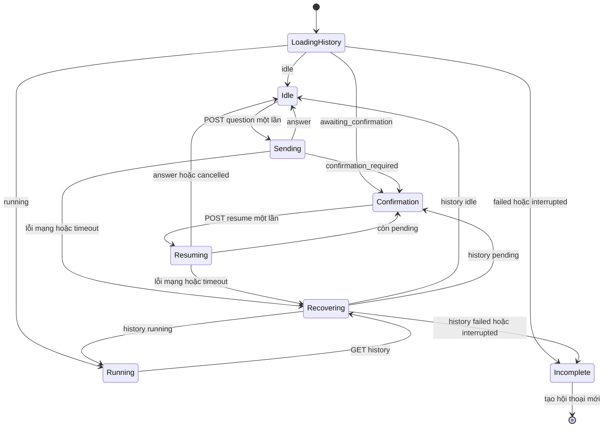

# CV RAG Agentic — Kế hoạch thiết kế và triển khai Frontend

**Ngày lập:** 18/10/2026  
**Trạng thái:** Bản kế hoạch để review thiết kế trước khi code FE.  
**Vị trí dự kiến:** `frontend/` trong repository `cv-rag-ai`.  
**Phạm vi:** Toàn bộ giao diện sản phẩm, triển khai theo từng đợt dựa trên mức sẵn sàng của API.

**Cập nhật thiết kế 19/10/2026:** đã chuẩn hóa prototype F1 từ HTML Stitch: login,
shell admin/tester, danh sách hội thoại, JD confirmation và các trạng thái lỗi/mobile.
Xem [hướng dẫn review](../../design/stitch_agentic_rag_cv_interface/README.md)
và [quy tắc thiết kế](../../design/stitch_agentic_rag_cv_interface/cognitive_talent_system/DESIGN.md).
Prototype dùng dữ liệu giả, chưa triển khai Next.js/BFF hoặc nối API; cần duyệt
giao diện trước khi coi D0/F1 đã hoàn thành.

## 1. Mục tiêu và căn cứ

Xây giao diện web cho HR tra cứu CV bằng hội thoại, chọn ứng viên theo JD, đánh giá,
chuẩn bị phỏng vấn, gửi thư mời và theo dõi hoạt động AI. Giao diện cần giúp người
dùng chọn ứng viên bằng tên/hồ sơ thay cho việc chép ID giữa các tab.

Kế hoạch được đối chiếu với:

- `app.py`, `src/auth/ui.py`: giao diện Streamlit và phân quyền hiện tại.
- `src/api/routes/`, `src/api/schemas/`: API auth, hội thoại, chat và feedback đã có.
- [Hợp đồng API](../api/contract.md) và [hướng dẫn API](../api/setup.md).
- Các service trong `src/interfaces/`, `src/retrieval/`, `src/interview/`,
  `src/notification/`, `src/ops/`, cùng model trong `src/db/models.py`.

Đây là thiết kế đề xuất. Danh sách route, component và API mở rộng bên dưới chưa
đồng nghĩa các chức năng đó đã được triển khai.

### 1.1. Những gì đã sẵn sàng

API hiện hỗ trợ đăng nhập/đăng xuất, lấy identity, tạo/liệt kê/đọc/xóa hội thoại,
gửi câu hỏi, resume theo confirmation ID và feedback theo message ID.

Các nghiệp vụ ứng viên, đánh giá, email, phỏng vấn và Ops đã có phần xử lý Python
hoặc giao diện Streamlit; cần thêm HTTP API trước khi nối các màn FE tương ứng.
Một số màn như dashboard tổng quan, quản lý job/phòng ban và tiến độ upload là
phần mở rộng sản phẩm, cần hoàn thiện cả service lẫn API.

### 1.2. Cách chia phạm vi

| Đợt | Phần triển khai | Điều kiện |
| --- | --- | --- |
| D0 | Luồng sử dụng, wireframe, UI kit, prototype | Chốt bản thiết kế trước khi dựng màn hình |
| F1 | Login, phiên đăng nhập, chat, JD confirmation, feedback, xóa/logout | Dùng API đang có; bổ sung lớp phiên trình duyệt ở Next.js |
| F2 | Ứng viên, chi tiết CV, đánh giá JD, Top-K, câu hỏi phỏng vấn | Có API đọc ứng viên và các API nghiệp vụ tương ứng |
| F3 | Email đơn lẻ/hàng loạt, tiến độ batch, upload CV và ingestion jobs | Có API thao tác, xác nhận, chống gửi trùng và theo dõi tác vụ |
| F4 | System Ops, optimization/experiment, tài khoản, phòng ban/job posting, dashboard | Có API admin và contract trạng thái/report rõ ràng |

Thiết kế bố cục tổng thể ngay từ D0 để mở rộng nhất quán. Chỉ đưa menu của các
module đã có chức năng thật vào bản phát hành; prototype có thể chứa toàn bộ màn.

## 2. Người dùng và quyền truy cập

Giữ hai role hiện có. Trong giai đoạn này, `admin` đồng thời thực hiện nghiệp vụ HR;
chưa thêm một role HR riêng khi backend chưa hỗ trợ.

| Khu vực/thao tác | Tester | Admin |
| --- | --- | --- |
| Login/logout, xem thông tin tài khoản hiện tại | Có | Có |
| Hội thoại, feedback, JD confirmation | Hội thoại của mình | Hội thoại của mình |
| Phạm vi CV khi chat | Phòng ban được cấp | Theo phạm vi backend cho phép |
| Màn ứng viên, đánh giá, Top-K, phỏng vấn | Chưa mở màn riêng | Có khi API hoàn thành |
| Email, ingestion jobs, upload CV | Chưa mở | Có khi API hoàn thành |
| Ops, optimization, quản lý tài khoản/phòng ban | Không | Có khi API hoàn thành |
| Đọc hội thoại của người khác | Không | Không |

Ẩn menu theo identity để người dùng dễ hiểu. FastAPI vẫn phải kiểm tra quyền trên
mỗi request, kể cả khi người dùng tự nhập URL. Tester không được chọn hoặc thay
department bằng form, query string hoặc nội dung prompt.

Hiện backend giới hạn tool của tester trong agent; quyền của menu FE không thay
thế việc giới hạn tool đó. Không đưa CV của nhiều phòng ban xuống trình duyệt rồi
mới lọc bằng JavaScript.

## 3. Sơ đồ màn hình và điều hướng

### 3.1. Danh mục route dự kiến

| Mã màn | URL trình duyệt | Nội dung | Role | Đợt |
| --- | --- | --- | --- | --- |
| AUTH-01 | `/login` | Đăng nhập | Public | F1 |
| CHAT-01 | `/chat` | Chat mới, hướng dẫn bắt đầu | Cả hai | F1 |
| CHAT-02 | `/chat/[threadId]` | Lịch sử, gửi câu hỏi, feedback, xác nhận JD | Chủ hội thoại | F1 |
| CAND-01 | `/candidates` | Danh sách, tìm kiếm/lọc ứng viên | Admin | F2 |
| CAND-02 | `/candidates/[candidateId]` | Hồ sơ ứng viên, CV và hành động liên quan | Admin | F2 |
| EVAL-01 | `/evaluations/new` | Đánh giá một ứng viên theo JD | Admin | F2 |
| MATCH-01 | `/matching` | Nhập JD, xem/sửa tiêu chí, Top-K | Admin | F2 |
| INT-01 | `/interviews` | Chọn ứng viên, xem/sinh câu hỏi phỏng vấn | Admin | F2 |
| MAIL-01 | `/emails/compose` | Soạn, xem trước và gửi một thư mời | Admin | F3 |
| MAIL-02 | `/emails/bulk` | Soạn nháp và duyệt nhiều thư | Admin | F3 |
| MAIL-03 | `/emails/batches/[batchId]` | Tiến độ gửi batch | Admin | F3 |
| MAIL-04 | `/emails/history` | Lịch sử gửi và kết quả từng người nhận | Admin | F3 |
| ING-01 | `/ingestion/upload` | Upload CV và theo dõi việc tiếp nhận | Admin | F3 |
| ING-02 | `/ingestion/jobs` | Danh sách job, bộ lọc trạng thái | Admin | F3 |
| ING-03 | `/ingestion/jobs/[jobId]` | Chi tiết job, lỗi và ứng viên tạo ra | Admin | F3 |
| OPS-01 | `/ops` | Usage, token, chi phí ước tính, latency, cảnh báo | Admin | F4 |
| OPS-02 | `/ops/optimization` | Cấu hình đang dùng và danh sách đề xuất | Admin | F4 |
| OPS-03 | `/ops/optimization/[proposalId]` | So sánh cấu hình, experiment, approve/rollback | Admin | F4 |
| ADM-01 | `/admin/users` | Danh sách tài khoản, tạo, khóa/mở | Admin | F4 |
| ADM-02 | `/admin/departments` | Danh sách/tạo phòng ban | Admin | F4 |
| ADM-03 | `/admin/job-postings` | Danh sách/tạo vị trí tuyển, gắn phòng ban | Admin | F4 |
| HOME-01 | `/dashboard` | Tổng quan, việc cần xử lý, lối tắt | Admin | F4, mở rộng |
| SYS-01 | `/forbidden` | Không đủ quyền | Đã đăng nhập | F1 |
| SYS-02 | `not-found` / `error` | Không tìm thấy, lỗi tải trang | Tùy ngữ cảnh | F1 |

`/` chuyển về `/chat` trong F1. Khi dashboard sẵn sàng, admin có thể vào
`/dashboard`, tester tiếp tục vào `/chat`. Đổi route mặc định không làm mất các URL chat cũ.

Màn kết quả đánh giá/Top-K dùng ngay trong trang thao tác ở F2. Chỉ thêm URL
`/evaluations/[id]` hoặc `/matching/[id]` khi backend có lưu kết quả và API đọc lại;
không dùng ID giả để tạo cảm giác kết quả đã được lưu bền.

### 3.2. Các khu vực trong menu

```text
CV RAG
├── Hỏi đáp AI
│   ├── Cuộc trò chuyện mới
│   └── Hội thoại gần đây
├── Tuyển dụng [admin, F2]
│   ├── Ứng viên
│   ├── Đánh giá theo JD
│   ├── Tìm ứng viên theo JD
│   └── Câu hỏi phỏng vấn
├── Thư mời [admin, F3]
│   ├── Soạn thư
│   ├── Gửi hàng loạt
│   └── Lịch sử gửi
├── Tiếp nhận CV [admin, F3]
│   ├── Upload CV
│   └── Tác vụ xử lý
├── Vận hành [admin, F4]
│   ├── System Ops
│   └── Đề xuất tối ưu
└── Quản trị [admin, F4]
    ├── Tài khoản
    ├── Phòng ban
    └── Vị trí tuyển dụng
```

Footer sidebar: username, role, tên phòng ban khi API có cung cấp, menu đăng xuất.
API `/auth/me` hiện chỉ có department ID; không tự suy đoán tên phòng ban.

### 3.3. Liên kết giữa các chức năng



Các liên kết tuyển dụng/admin chỉ xuất hiện sau khi API và quyền tương ứng sẵn sàng.
Trong F1, câu trả lời chat chỉ có text; không giả định backend đã trả structured
candidate cards. Liên kết hồ sơ trong chat cần format có cấu trúc hoặc ID được
backend xác minh trước khi thiết kế thành tính năng chính thức.

## 4. Thiết kế giao diện trước khi code

### 4.1. Định hướng hình ảnh

- Sản phẩm nghiệp vụ HR, giao diện tiếng Việt, ưu tiên đọc CV và kết quả dài.
- Desktop là thiết bị chính; mobile đáp ứng login, đọc/gửi chat, confirmation.
- Nền trung tính sáng, một màu nhấn cho hành động chính; màu cảnh báo/lỗi riêng.
- Một font sans-serif hỗ trợ đầy đủ dấu tiếng Việt; body mặc định khoảng 16 px.
- Sidebar desktop khoảng 240–280 px; nội dung chat đọc ở chiều rộng khoảng 760–900 px.
- Bảng dữ liệu dùng chiều rộng linh hoạt; form dài chia nhóm có nhãn rõ ràng.
- Chỉ dùng biểu tượng đơn độc khi có nhãn truy cập/tooltip, ví dụ xóa hội thoại.
- Token thiết kế cho spacing, font, radius và màu dùng thống nhất; dark mode là bước sau.

Các kích thước/màu trên là điểm bắt đầu để review, chưa phải bộ nhận diện đã chốt.

### 4.2. File thiết kế cần tạo

Có thể dùng Figma hoặc công cụ tương đương, tổ chức thành các trang:

1. `00 — Scope & Flows`: sitemap, role và luồng sử dụng.
2. `01 — Foundations`: màu, typography, spacing, icon, layout desktop/mobile.
3. `02 — Components`: button, input, table, dialog, toast, empty/error/loading states.
4. `03 — Auth & Chat`: toàn bộ F1 và các trạng thái lỗi.
5. `04 — Candidates & Matching`: ứng viên, đánh giá, Top-K và phỏng vấn.
6. `05 — Emails & Ingestion`: soạn/gửi thư, tiến độ batch, upload và jobs.
7. `06 — Ops & Admin`: usage, đề xuất/experiment, tài khoản, phòng ban/vị trí tuyển.
8. `07 — Prototype & Handoff`: prototype có liên kết và chú thích hành vi/API.

Mỗi frame có mã màn, role, trạng thái, dữ liệu mẫu giả lập và hành động khi bấm nút.
Dùng dữ liệu CV giả để thiết kế/chụp màn hình; tránh đưa PII thật vào file thiết kế dùng chung.

### 4.3. Điều kiện duyệt thiết kế D0

- Xem được toàn bộ đường đi từ login đến chat, confirmation, feedback và logout.
- Phân biệt rõ admin/tester, trạng thái đang chạy, lỗi và chưa có dữ liệu.
- Có wireframe tổng thể cho các module sau; F1 có thiết kế chi tiết và prototype.
- Không có nút nghiệp vụ chưa rõ dữ liệu đầu vào, kết quả hoặc điều kiện bật/tắt.
- Review ít nhất ở desktop 1440 px và mobile 390 px; kiểm tra reflow ở 320 px khi code.
- Prototype thể hiện xóa hội thoại, phiên hết hạn, nhiều JD confirmation và quota lỗi.

## 5. Đặc tả các màn hình

### 5.1. AUTH-01 — Đăng nhập

**Thành phần:** tên sản phẩm, mô tả ngắn, username, password, hiện/ẩn mật khẩu,
nút Đăng nhập, thông báo lỗi cạnh form. Không có tự đăng ký vì tài khoản do admin cấp.

**Hành vi:** cho phép paste/password manager; Enter gửi form; chặn submit lặp trong
lúc chờ; không trim/chuyển đổi mật khẩu. FE kiểm tra có giá trị và giới hạn theo API.
Quy tắc tối thiểu 12 ký tự áp dụng khi tạo tài khoản, không tự áp sang form login.

**Trạng thái:** mặc định, đang đăng nhập, credentials không hợp lệ/tạm khóa,
backend không khả dụng, phiên hết hạn quay lại login. Sau thành công vào URL nội bộ
được phép đã yêu cầu trước đó, hoặc `/chat`; kiểm tra redirect để tránh chuyển ra URL ngoài.

### 5.2. CHAT-01/02 — Không gian hội thoại

**Bố cục:** sidebar hội thoại, header tên hội thoại, vùng messages, composer cố định
phía dưới. Mobile đưa sidebar vào drawer, không để composer bị bàn phím che.

- Chat mới có gợi ý câu hỏi dạng text, ví dụ tra cứu Python hoặc tìm ứng viên theo JD.
- Chỉ tạo hội thoại khi người dùng chủ động tạo/gửi câu đầu; reload `/chat` không
  tự tạo hàng loạt hội thoại rỗng. Khi POST tạo thành công, chuyển URL sang thread thật.
- Danh sách lấy tối đa 50 theo API; hiển thị rõ đây là hội thoại gần đây. Tìm kiếm
  phía client nếu có chỉ áp dụng trên danh sách đã tải; tìm toàn bộ cần API bổ sung.
- Messages hiển thị user/assistant, hỗ trợ Markdown an toàn, xuống dòng và bảng dài.
  Không chạy raw HTML/script, không hiển thị tool nội bộ hoặc reasoning.
- Composer có giới hạn 20.000 ký tự, Shift+Enter xuống dòng, gửi bằng nút; hỗ trợ
  Enter gửi khi không trong quá trình gõ IME. Lưu bản nháp tạm riêng từng thread trong bộ nhớ.
- Khi đang gửi, giữ dấu đang xử lý, vô hiệu hóa gửi lặp và confirmation trùng.
  Chưa có streaming, phần trăm tiến độ, stop hay cancel graph ở API hiện tại.
- Gửi xong refetch history và danh sách để đồng bộ ID/title/order; không ghép trùng
  tin nhắn tạm với tin đã lưu. Cuộn theo tin mới nếu người dùng ở cuối, có nút về
  cuối khi người dùng đang đọc nội dung cũ.
- Feedback 👍/👎 gắn assistant message ID. Hiện xác nhận đã ghi nhận sau 201.
  Backend đang append, không hiển thị như nút vote toggle có lưu trạng thái bền;
  đổi lựa chọn/upsert hoặc đọc lại vote cần contract/schema bổ sung.
- Xóa có dialog xác nhận; nếu đang mở thread bị xóa, về `/chat`.
  Lỗi cleanup pending cần giữ ID để retry DELETE dù thread đã ẩn khỏi sidebar.

### 5.3. Form xác nhận JD trong chat

Đặt card ngay trong luồng chat, có nhãn “Cần xác nhận trước khi tìm ứng viên”.
Không buộc dùng modal che nội dung JD dài.

| Trường | Kiểu/giới hạn |
| --- | --- |
| Vị trí | Chuỗi 1–500 ký tự, không chỉ khoảng trắng |
| Kỹ năng | Danh sách chip/text, tối đa 100; mỗi kỹ năng 1–200 ký tự |
| Kinh nghiệm tối thiểu | Số không âm hoặc để trống = null; giữ được giá trị 0 |
| Học vấn ưu tiên | Chuỗi tối đa 1.000 ký tự hoặc null |
| Số ứng viên | Integer 1–10 |

- Hiển thị đầy đủ `pending_confirmations[]`, mỗi card giữ đúng `confirmation_id`.
- Có hai hành động: “Xác nhận và tìm kiếm” / “Hủy yêu cầu”. Hủy vẫn cần gọi resume.
- Chỉ gửi các trường đã sửa; trường bỏ qua giữ nguyên, không biến tất cả thành null.
- Key của form gồm thread ID và confirmation ID để dữ liệu card trước không tràn sang card sau.
- Khi đang có pending, chuyển composer sang hướng dẫn xử lý form; không gửi câu hỏi mới.
- Reload GET history phải dựng lại đúng form. Khi STALE_CONFIRMATION, refetch và
  đối chiếu tiêu chí mới trước khi người dùng xác nhận lại.
- Sau resume: answer thì hiển thị câu trả lời; còn pending thì dựng danh sách còn lại;
  cancelled thì hiển thị đã hủy dù message có thể null.

### 5.4. CAND-01/02 — Ứng viên và hồ sơ

**Danh sách:** tìm kiếm, lọc kỹ năng/vị trí/phòng ban theo contract đã hỗ trợ,
bảng tên, vị trí ứng tuyển, kinh nghiệm, kỹ năng, ngày tiếp nhận. Bộ lọc và phân
trang đặt trong URL để quay lại vẫn giữ được điều kiện.

**Chi tiết:** thông tin liên hệ, vị trí, kinh nghiệm, học vấn, kỹ năng, chứng chỉ,
dự án, ảnh nếu có; tab nội dung CV đã trích xuất. PDF gốc chỉ xuất hiện khi backend
có endpoint file được kiểm tra quyền và dữ liệu gốc còn tồn tại.

**Liên kết:** từ hồ sơ chọn Đánh giá / Câu hỏi phỏng vấn / Soạn thư mời, truyền
candidate ID nội bộ và hiển thị tên người đã chọn. Có link về danh sách giữ filter.

API ảnh/PDF có kiểm tra quyền hoặc URL tạm; FE không truy cập trực tiếp MinIO bằng
credential. Không thêm nút sửa/xóa CV khi backend chưa có nghiệp vụ tương ứng.

### 5.5. EVAL-01 — Đánh giá theo JD

- Tìm/chọn ứng viên bằng tên, hoặc nhận candidate ID từ trang hồ sơ.
- Nhập JD text; upload PDF JD chỉ mở sau khi có API xử lý file/OCR.
- Hiển thị ứng viên và JD trước nút Đánh giá; đang chạy khóa nút lặp.
- Kết quả: điểm tổng theo thang backend, điểm từng tiêu chí, giải thích, điểm mạnh,
  lưu ý và tóm tắt. Giữ rõ JD và ứng viên đã dùng để tạo kết quả.
- Sửa input sau khi có kết quả phải đánh dấu kết quả cũ; không trình bày như đã tính lại.
- Chuyển từ kết quả sang hồ sơ/phỏng vấn/soạn thư. Chưa coi kết quả lưu trên FE là
  lịch sử đánh giá bền; lưu report cần service/model/API riêng.

### 5.6. MATCH-01 — Top-K theo JD

Luồng: nhập JD → trích xuất → xem/sửa tiêu chí → xác nhận → xếp hạng → kết quả.
Trang riêng và form chat dùng chung component criteria và component giải thích điểm,
nhưng API/page state riêng phải được đặc tả trước khi nối.

Kết quả gồm vị trí xếp hạng, tên ứng viên, kỹ năng, điểm và giải thích; mở hồ sơ từ
từng dòng, chọn nhiều người để soạn thư hàng loạt. Chỉ hiển thị các field backend
trả, không suy ra tỷ lệ “phù hợp 95%” từ điểm rubric hoặc điểm retrieval.

Trạng thái cần thiết kế: chưa nhập JD, trích xuất, chờ duyệt, đang xếp hạng,
không có ứng viên phù hợp, thành công và lỗi quota/provider.

### 5.7. INT-01 — Câu hỏi phỏng vấn

- Chọn ứng viên; số câu 3–15 theo thao tác hiện có trong Streamlit.
- Xem bộ câu hỏi đã lưu; nhóm Technical, System Design và Soft Skill.
- Mỗi câu có trích dẫn CV và section nguồn để HR kiểm tra.
- Sinh mới hiển thị cảnh báo sẽ thay bộ cũ; lỗi sinh mới không được làm mất bộ
  đã lưu nếu backend chưa hoàn tất thao tác thay thế.
- Xóa toàn bộ câu hỏi cần xác nhận, sau đó refetch.
- Link về hồ sơ. Xuất PDF/doc là tính năng bổ sung, chưa nằm trong phạm vi đầu.

### 5.8. MAIL-01/02/03/04 — Thư mời

**Đơn lẻ:** chọn ứng viên → nhập vị trí và chi tiết phỏng vấn → tạo draft → chỉnh
subject/body → xem trước người nhận → xác nhận gửi. Cảnh báo nếu đã gửi trước đó.
Đổi ứng viên sau khi soạn phải reset hoặc đánh dấu draft cũ để tránh gửi nhầm người.

**Hàng loạt:** nhận danh sách từ ứng viên/Top-K → tạo draft → bảng chọn người nhận,
sửa subject/body → tổng số thư → xác nhận gửi → trang tiến độ batch.
Những người tạo draft lỗi phải có lý do an toàn, không được chọn gửi.

**Tiến độ:** có batch ID thật trong URL, trạng thái từng người nhận, đã xử lý/thành
công/thất bại và nút về hồ sơ. API hiện tại chỉ tổng hợp các log đã ghi; API mở rộng
phải có tổng số dự kiến và trạng thái task trước khi FE có thể hiện phần trăm/hoàn tất.

**Lịch sử:** lọc thời gian/kết quả/ứng viên, xem nội dung và thời điểm gửi, liên kết
batch và hồ sơ. Không coi việc quay lại trang là thao tác gửi lại.

Gửi thật luôn là hành động admin xác nhận rõ ràng; tạo draft hoặc chat không tự
gửi thư. Trước khi phát hành cần server-side idempotency cho send/bulk dispatch;
khóa nút FE chỉ giúp ngăn bấm lặp, không xử lý được mọi trường hợp mất kết nối.

### 5.9. ING-01/02/03 — Tiếp nhận CV

- Upload bằng nút chọn file hoặc kéo/thả; bảng file, trạng thái gửi và kết quả validate.
- Phân biệt “đã upload” với “đã xử lý/index xong”; chỉ hiện upload progress khi đo
  được byte thật, còn ingestion là trạng thái do backend cung cấp.
- Giới hạn file theo backend; hiện mặc định PDF, 20 KB–50 MB, tối đa 10 trang và
  quy ước tên file. Nên có API capability/config an toàn hoặc contract cố định để FE
  hiển thị đúng khi cấu hình thay đổi.
- Trang jobs lọc trạng thái và nguồn nhận; chi tiết job hiển thị attempt, thông báo
  an toàn, thời điểm cập nhật, link ứng viên khi đã tạo.
- Bộ tên trạng thái xử lý phải chốt với pipeline trước khi dựng badge; không tự
  chuyển status bằng thao tác FE. Retry job DLQ cần API/admin gate riêng.
- Quản lý gắn vị trí/phòng ban cho CV upload cần bổ sung service, không để client
  tự gán scope tùy ý. CV chưa gắn job posting có thể không truy cập được bởi tester.
- API chat hiện tại chỉ nhận text; file đính kèm chat là hạng mục riêng, không dùng
  upload ingestion để mặc định thêm CV mới mỗi lần HR muốn hỏi về tài liệu.

### 5.10. OPS-01 — System Ops

Giữ các chỉ số có thật: số lần gọi AI, input/output token, chi phí đã định giá,
tỷ lệ lỗi, median/p95 latency, failover attempts, DLQ count, thống kê module/model,
usage theo thời gian và log gần nhất. Mỗi chỉ số ghi rõ phạm vi thời gian/filter;
DLQ toàn hệ thống không được trình bày như chỉ thuộc khoảng đã chọn.

Các trạng thái chi phí phải khác nhau:

- `0`: có cấu hình giá và dữ liệu đủ, tính ra 0 (ví dụ free tier).
- `null`: chưa định giá hoặc chưa đủ usage; hiển thị “Chưa xác định”.
- Một phần có giá: ghi tổng phần đã định giá và số call thiếu, không gọi là tổng chi phí đầy đủ.

Ghi “chi phí ước tính” và pricing version, không trình bày như hóa đơn provider.
Free tier có thể chứng minh giảm calls/token/latency nhưng chưa chứng minh tiết kiệm
tiền khi cả baseline và proposal đều có giá 0.

### 5.11. OPS-02/03 — Đề xuất tối ưu và experiment

- Cấu hình đang dùng: extraction model, pinned prompt commit, cache, retrieval multiplier.
- Tạo đề xuất thủ công hoặc phân tích usage bằng AI; cả hai chỉ tạo proposal.
- Chi tiết đề xuất: diff baseline/proposal, dataset, thời điểm chạy, các chỉ số và
  report backend; không tự suy ra trạng thái passed bằng logic riêng của FE.
- Nút experiment nêu rõ có gọi model thật. Khi triển khai API cần trạng thái tác vụ
  có thể đọc lại; runner hiện tại đồng bộ, chưa phải job nền có tiến độ.
- Approve chỉ khả dụng khi report hợp lệ và baseline còn khớp; backend vẫn phải
  kiểm tra lại lúc approve. Nếu cấu hình gốc thay đổi, hướng dẫn chạy experiment lại.
- Rollback chọn phiên bản đã được approve hoặc defaults, có xác nhận rõ mục tiêu.
- Report hiện tập trung extraction và scoring bằng code; thay retrieval multiplier
  cần labeled retrieval experiment mà runner hiện chưa hỗ trợ. Giao diện phải nêu
  điều kiện này, không cho hiểu rằng mọi đề xuất đều có thể approve qua runner đó.
- Lợi ích cache/độ chính xác hiển thị đúng phạm vi phép đo, không thêm LLM judge,
  routing theo độ khó hoặc kết luận semantic quality khi backend chưa có.

### 5.12. ADM-01 — Quản lý tài khoản

Bảng username, role, phòng ban, trạng thái; form tạo username/password/role và
department bắt buộc với tester. Password mới 12–256 ký tự; không lưu trong state bền/log.

Khóa/mở tài khoản có dialog tên người đích, refetch sau thành công; không cho tự
khóa tài khoản admin đang dùng. Đảm bảo khóa hoặc đổi quyền thu hồi/kiểm tra lại
phiên ở backend. Lịch sử của người bị khóa vẫn giữ theo chính sách hiện tại.

Reset password đang có qua CLI, chưa có API. Có thể thiết kế dialog admin reset ở
bước mở rộng sau khi chốt contract; không dựng “Quên mật khẩu” hoặc tự đổi role
ở trang cá nhân khi chưa có nghiệp vụ tương ứng.

### 5.13. ADM-02/03 — Phòng ban và vị trí tuyển

Danh sách/tạo phòng ban; danh sách/tạo vị trí tuyển thuộc phòng ban; hiển thị số CV
theo dữ liệu API nếu có. Các thao tác sửa, tắt vị trí, gán lại ứng viên là phần cần
bổ sung service/API và quy tắc quyền, chưa được coi là CRUD hoàn chỉnh đang có.

Liên kết từ phòng ban → các vị trí → danh sách CV tương ứng. Khi chưa có CV, hiển
thị trạng thái trống và hướng dẫn chuẩn bị dữ liệu, không hiển thị lỗi hệ thống.

### 5.14. HOME-01 — Tổng quan và màn hệ thống

Dashboard admin làm sau: số CV, job cần xử lý, tình trạng gửi thư, usage tóm tắt và
lối tắt về ứng viên/jobs/Ops. Mỗi card cần API aggregate và định nghĩa thời gian;
không tải toàn bộ dữ liệu về FE để tự tổng hợp như dữ liệu toàn hệ thống.

Các màn chung: chưa có dữ liệu, đang tải, 403, 404, lỗi trang, backend tạm ngừng,
phiên hết hạn. Thông báo hiển thị hành động tiếp theo; request ID có nút copy để
hỗ trợ tra log. Không hiện raw stack trace, API key hoặc DSN.

## 6. Kiến trúc FE và phiên đăng nhập

### 6.1. Công nghệ dự kiến

| Phần | Lựa chọn đề xuất | Lý do |
| --- | --- | --- |
| Framework | Next.js App Router + TypeScript | Có layout, routing và lớp server cùng project FE |
| Styling | Tailwind CSS, token thiết kế dùng CSS variables | Dễ giữ cùng spacing, màu và responsive |
| Component cơ bản | shadcn/ui hoặc component tương đương đã kiểm tra accessibility | Button, dialog, input, table dùng nhất quán |
| Dữ liệu API trên client | TanStack Query | Cache theo user/thread, refetch và mutation state |
| HTTP | Fetch và adapter lỗi chung | Không cần thêm một HTTP client chỉ để gọi JSON |
| Form | React Hook Form + Zod khi form phức tạp | Criteria, email grid và form admin có validation rõ |
| Test | Vitest/Testing Library và Playwright | Kiểm tra component và luồng trình duyệt |

Chọn các phiên bản tương thích khi scaffold và commit lockfile của một package
manager, đề xuất npm. Chưa cần Redux, Turborepo hoặc nhiều package workspace cho
một frontend. Thêm thư viện chart/bảng nâng cao khi bắt đầu module tương ứng.

Next.js tổ chức route bằng thư mục và hỗ trợ route group/layout dùng chung; cấu
trúc bên dưới dựa trên quy ước đó. Tham khảo [Project Structure](https://nextjs.org/docs/app/getting-started/project-structure)
và [Layouts and Pages](https://nextjs.org/docs/app/getting-started/layouts-and-pages).

### 6.2. Kết nối trình duyệt, Next.js và FastAPI

Đề xuất dùng Next.js làm BFF — lớp server trung gian dành cho giao diện. Cách này
cho phép giữ phiên qua reload bằng cookie HttpOnly, đồng thời dùng lại session
opaque trong MySQL của FastAPI.



Đây là lựa chọn kiến trúc cho dự án, dựa trên khả năng [BFF của Next.js](https://nextjs.org/docs/app/guides/backend-for-frontend)
và hướng dẫn về [cookie/session, authorization](https://nextjs.org/docs/app/guides/authentication).
Lớp session/BFF chưa tồn tại; cần triển khai và kiểm thử ở F1.

Quy tắc triển khai:

1. Browser gọi cùng origin Next.js; BFF đọc cookie và thêm bearer khi gọi FastAPI.
   Không chuyển `access_token` vào JSON trả browser, localStorage hoặc sessionStorage.
2. Cookie chứa opaque token backend; HttpOnly, SameSite=Lax, Path=/, Secure trên
   HTTPS production; tuổi cookie không vượt `expires_at` thực tế. Không tự gia hạn
   phiên 12 giờ hoặc tạo thêm hệ thống JWT/account song song.
3. Kiểm tra Origin và bảo vệ CSRF cho request thay đổi dữ liệu, kể cả login/logout;
   không coi riêng SameSite hoặc CORS là đầy đủ. Nếu cần CSRF token, đặc tả và
   kiểm thử cơ chế đó trong lớp BFF trước khi phát hành.
4. Proxy dùng upstream cố định từ cấu hình server, allowlist path/method; không nhận
   URL đích từ client. Chặn header/cookie không cần thiết, tránh biến thành open proxy.
5. Login/auth failure: xóa state nhạy cảm; 401 ở request có phiên → clear cookie,
   cache và nháp, về login. 403 không đồng nghĩa hết phiên, giữ identity và hiện lỗi quyền.
6. Logout gọi FastAPI thu hồi session rồi xóa cookie và cache. Nếu backend không
   xác nhận thu hồi, vẫn xóa trạng thái browser và thông báo rõ kết quả chưa đầy đủ;
   không báo đã thu hồi phiên thành công khi chỉ mới xóa cookie.
7. Dữ liệu riêng tư dùng no-store/không cache dùng chung ở server/CDN; response
   cá nhân có Cache-Control phù hợp. Query cache phía client có user ID trong key,
   được hủy request đang chờ và xóa sạch khi logout/đổi tài khoản.
8. Next.js có thể kiểm tra session để điều hướng, nhưng FastAPI quyết định quyền
   nghiệp vụ. Không chỉ kiểm tra trong layout/menu rồi bỏ qua các Route Handler.
9. Forward error envelope và X-Request-ID của backend; lỗi do BFF tạo có request ID
   riêng, thông báo an toàn. Không log password, cookie hoặc Authorization.
10. BFF timeout/client disconnect không chứng minh graph đã dừng. Cần thiết kế
    recovery qua GET history như mục 8; không tự resend POST.

Phương án browser gọi FastAPI trực tiếp bằng bearer trong bộ nhớ vẫn có thể dùng
cho bản prototype ngắn hạn; refresh cần login lại. Bản triển khai trong kế hoạch
này ưu tiên BFF để thống nhất thiết kế phiên bền. Nếu đổi lựa chọn, cập nhật tài
liệu và test auth trước khi code các màn phụ thuộc.

### 6.3. Cấu hình và triển khai

- Frontend: một app Next.js trong `frontend/`, server local cổng 3000.
- FastAPI: cổng 8000, vẫn một writer process cho checkpoint hiện tại.
- `.env.local` của FE có biến server-only như `API_INTERNAL_URL=http://127.0.0.1:8000`.
  Khi deploy container/server khác, URL phải là địa chỉ backend mà Next server truy cập được.
- Không đưa Gemini key, LangSmith key, DB/Redis/MinIO credentials vào biến `NEXT_PUBLIC_*`.
- Khi dùng BFF, request browser đến cùng origin; cấu hình CORS backend vẫn cần đúng
  nếu còn client gọi trực tiếp. Cookie/HTTPS và Origin phải khớp domain triển khai.
- Có Next server cho BFF, không dùng static export cho kiến trúc này.
- Chat đồng bộ có thể vượt timeout của nền tảng hosting/proxy. Kiểm tra giới hạn
  request trước khi chọn nơi deploy; nếu không đáp ứng cần background chat jobs và
  contract tương ứng, không chỉ tăng thời gian chờ ở browser.
- Chạy API và Streamlit cùng ghi một checkpoint hoặc tăng số workers cần cơ chế
  coordination dùng chung; khóa trong process hiện tại chưa đáp ứng trường hợp đó.

## 7. Cấu trúc thư mục đề xuất

```text
cv-rag-ai/
├── frontend/
│   ├── package.json
│   ├── package-lock.json
│   ├── next.config.ts
│   ├── tsconfig.json
│   ├── eslint.config.mjs
│   ├── .env.example
│   ├── public/
│   ├── src/
│   │   ├── app/
│   │   │   ├── layout.tsx
│   │   │   ├── page.tsx                  # redirect theo phiên/role
│   │   │   ├── globals.css
│   │   │   ├── providers.tsx
│   │   │   ├── error.tsx
│   │   │   ├── not-found.tsx
│   │   │   ├── (auth)/login/page.tsx
│   │   │   ├── (workspace)/
│   │   │   │   ├── layout.tsx           # shell dùng chung
│   │   │   │   ├── loading.tsx
│   │   │   │   ├── chat/page.tsx
│   │   │   │   ├── chat/[threadId]/page.tsx
│   │   │   │   ├── forbidden/page.tsx
│   │   │   │   └── (admin)/
│   │   │   │       ├── layout.tsx       # admin gate, không thêm URL segment
│   │   │   │       ├── dashboard/page.tsx
│   │   │   │       ├── candidates/page.tsx
│   │   │   │       ├── candidates/[candidateId]/page.tsx
│   │   │   │       ├── evaluations/new/page.tsx
│   │   │   │       ├── matching/page.tsx
│   │   │   │       ├── interviews/page.tsx
│   │   │   │       ├── emails/
│   │   │   │       │   ├── compose/page.tsx
│   │   │   │       │   ├── bulk/page.tsx
│   │   │   │       │   ├── history/page.tsx
│   │   │   │       │   └── batches/[batchId]/page.tsx
│   │   │   │       ├── ingestion/
│   │   │   │       │   ├── upload/page.tsx
│   │   │   │       │   ├── jobs/page.tsx
│   │   │   │       │   └── jobs/[jobId]/page.tsx
│   │   │   │       ├── ops/
│   │   │   │       │   ├── page.tsx
│   │   │   │       │   ├── optimization/page.tsx
│   │   │   │       │   └── optimization/[proposalId]/page.tsx
│   │   │   │       └── admin/
│   │   │   │           ├── users/page.tsx
│   │   │   │           ├── departments/page.tsx
│   │   │   │           └── job-postings/page.tsx
│   │   │   └── api/
│   │   │       ├── session/login/route.ts
│   │   │       ├── session/logout/route.ts
│   │   │       ├── session/me/route.ts
│   │   │       └── backend/[...path]/route.ts # proxy allowlist
│   │   ├── components/
│   │   │   ├── ui/                     # input, button, dialog, toast...
│   │   │   ├── layout/                 # shell, sidebar, header, mobile nav
│   │   │   └── shared/                 # error state, empty state, candidate picker
│   │   ├── features/
│   │   │   ├── auth/
│   │   │   ├── chat/
│   │   │   │   ├── components/
│   │   │   │   ├── hooks/
│   │   │   │   ├── api.ts
│   │   │   │   └── schemas.ts
│   │   │   ├── candidates/
│   │   │   ├── evaluations/
│   │   │   ├── matching/
│   │   │   ├── interviews/
│   │   │   ├── emails/
│   │   │   ├── ingestion/
│   │   │   ├── ops/
│   │   │   └── admin/
│   │   ├── lib/
│   │   │   ├── api/client.ts           # browser -> Next, lỗi chung
│   │   │   ├── api/server.ts           # Next -> FastAPI, server-only
│   │   │   ├── auth/session.ts         # cookie, lấy identity, server-only
│   │   │   ├── auth/permissions.ts
│   │   │   ├── api/proxy-policy.ts     # allowlist + Origin/CSRF policy
│   │   │   ├── query-keys.ts
│   │   │   └── formatters.ts
│   │   └── types/
│   │       └── api.generated.ts        # tạo từ OpenAPI khi contract ổn định
│   └── tests/
│       ├── components/
│       ├── integration/
│       ├── e2e/
│       └── fixtures/                   # dữ liệu giả
├── src/                                # backend Python hiện tại
├── main.py
├── app.py                              # Streamlit
└── docs/
    ├── api/
    └── frontend/FE_IMPLEMENTATION_PLAN.md
```

Đây là cấu trúc đích. Khi scaffold chỉ tạo file của F1; thêm từng feature khi bắt
đầu triển khai để tránh nhiều file rỗng. Page file điều phối route và component,
nghiệp vụ màn hình đặt trong `features/`, server-only module không import vào client.

Không tạo Git repository lồng trong `frontend/`. Cập nhật ignore cho `node_modules/`,
`.next/`, `.env.local`, test artifacts; giữ lockfile và `.env.example` không chứa secret.
`openapi.json` ở gốc hiện là file chưa tracked: trước khi dùng làm snapshot cần
xác minh nguồn xuất, cách cập nhật và đưa vào quy trình generate type có kiểm soát.

## 8. Contract dữ liệu, trạng thái và lỗi

### 8.1. Gắn thao tác F1 với API đã có

Các endpoint FastAPI sau đã tồn tại. Browser sẽ truy cập qua BFF ở kiến trúc đề xuất.

| Thao tác | FastAPI | FE xử lý |
| --- | --- | --- |
| Login | `POST /api/auth/login` | BFF nhận token, đặt cookie, chỉ trả identity/expiry an toàn |
| Khôi phục phiên | `GET /api/auth/me` | Lấy identity thật, dựng menu và cache theo user |
| Logout | `POST /api/auth/logout` | Thu hồi token, xóa cookie/cache/nháp |
| Tạo hội thoại | `POST /api/conversations` | Nhận ID thật, chuyển route |
| Danh sách | `GET /api/conversations?limit=50` | Hội thoại gần đây, không giả định pagination vô hạn |
| Lịch sử | `GET /api/conversations/{id}/messages` | Dựng messages và pending từ cùng snapshot |
| Gửi câu hỏi | `POST /api/conversations/{id}/messages` | Giữ mutation state, xử lý union response |
| Xác nhận/hủy JD | `POST /api/conversations/{id}/resume` | Gửi đúng ID + confirmed + partial edits |
| Feedback | `POST /api/conversations/{id}/feedback` | Chỉ gửi message ID và up/down |
| Xóa | `DELETE /api/conversations/{id}` | 204 xóa item; 503 cleanup pending cho retry đúng ID |

Lớp TypeScript giữ nguyên discriminated union `answer / confirmation_required /
cancelled`. Dùng message ID backend làm key và nhận dạng, không tạo ID mới mỗi lần GET.
Mọi trường nullable phải được thể hiện rõ, đặc biệt số năm, học vấn, chi phí và usage.

### 8.2. State machine cho chat



`Sending/Resuming/Recovering` là state UI; `execution_status` vẫn theo contract backend.
Nếu một request lỗi trước khi ghi checkpoint, history có thể vẫn idle. UI không
được chỉ dựa vào idle để kết luận lượt vừa gửi đã thành công: phải đối chiếu messages.

Khi mất mạng, mất response hoặc người dùng chuyển trang trong lúc chờ:

1. Không tự resend POST question/resume/send email/experiment.
2. Đọc lại history/status bằng GET sau khi kết nối lại.
3. Khi running, polling có khoảng nghỉ tăng dần, chỉ cho thread đang theo dõi;
   dừng khi idle/pending/failed/interrupted hoặc hết phiên. Một lượt xử lý lâu
   không được tự coi là thất bại chỉ vì FE hết thời gian polling.
4. Khi pending, dựng đúng card và ID mới nhất; khi failed/interrupted, hiện thông
   báo và nút tạo hội thoại mới. API hiện chưa có resume-from-error.
5. Client disconnect không hủy graph trong worker thread. Không vẽ nút “Dừng AI”
   có tác dụng hủy nếu backend chưa hỗ trợ.

### 8.3. Bảng lỗi và hành động

| HTTP / code | Phản hồi giao diện |
| --- | --- |
| 401 | Xóa phiên/cache, login lại; loại trừ lỗi credentials của chính form login |
| 403 | Hiện không đủ quyền, không tự logout |
| 404 CONVERSATION_NOT_FOUND | Bỏ mục stale trong danh sách, về chat mới; không tiết lộ chủ khác |
| 404 MESSAGE_NOT_FOUND | Làm mới history, bỏ feedback state không còn hợp lệ |
| 409 CONVERSATION_BUSY | Khóa mutation thread đó, đọc lại trạng thái |
| 409 CONFIRMATION_PENDING | Đọc history và hiện form xác nhận |
| 409 NO_PENDING_CONFIRMATION / STALE_CONFIRMATION | Refetch; không tự áp quyết định vào ID khác |
| 409 EXECUTION_INCOMPLETE | Hiện lượt cũ chưa hoàn tất, cho tạo hội thoại mới |
| 422 | Kiểm tra form, giới hạn input, không tự retry |
| 503 DEPENDENCY_UNAVAILABLE | Thông báo dịch vụ/model tạm không khả dụng, có request ID |
| 503 CONVERSATION_CLEANUP_PENDING | Ẩn thread đã tombstone, giữ đường retry DELETE cho chính chủ |
| 504 / mất kết nối | Đọc trạng thái để khôi phục, không coi tác vụ chắc chắn đã dừng |
| 500 | Lỗi chung an toàn, copy request ID, không tự resend mutation |

Hiện 503 không có retry-after/code quota riêng. FE không tự đoán số giây đếm
ngược hoặc khẳng định mọi 503 đều hết quota. Nếu muốn UX quota chi tiết, bổ sung
public error contract an toàn ở backend.

### 8.4. Query cache và dữ liệu giữa các trang

- Cache key có user ID; history thêm thread ID. Không dùng một key chung cho mọi user.
- Lọc/sort/phân trang dùng URL, còn draft/form tạm dùng feature state. Không đưa
  raw CV, mật khẩu, email body hoặc JD nhạy cảm vào query string.
- Candidate selection truyền ID đã được backend kiểm tra; trang đích fetch lại
  profile. Danh sách nhiều ID hoặc kết quả Top-K cần shared state tạm hoặc backend
  draft ID khi có lưu bền; không nhét hồ sơ đầy đủ vào URL.
- Kết quả cũ đang xem phải có nhãn rõ khi input đã đổi; phản hồi chậm từ thread
  trước không được chèn vào thread hiện tại.
- Query GET có retry hữu hạn cho lỗi tạm thời. POST/mutation cấu hình `retry: false`
  rõ ràng và kiểm tra cả adapter/BFF không retry ngầm. TanStack Query cho phép cấu
  hình retry; xem [Query Retries](https://tanstack.com/query/latest/docs/framework/react/guides/query-retries)
  và [Mutations](https://tanstack.com/query/latest/docs/framework/react/guides/mutations).

## 9. API cần bổ sung theo từng module

Các route dưới đây là **đề xuất để thiết kế contract**, chưa phải endpoint sẵn sàng.
Đợt backend mở rộng cần phân trang, schema output, auth/department scope, lỗi và
test ownership trước khi FE bỏ mock. BFF không được gọi thẳng DB để lấp chỗ thiếu API.

| Module | API/khả năng cần có | Phần nghiệp vụ có thể tái sử dụng |
| --- | --- | --- |
| Ứng viên | `GET /api/candidates`, `GET /api/candidates/{id}`, endpoint ảnh/CV có quyền | `sql_query_tool`, model Candidate, MinIO |
| Đánh giá | `POST /api/evaluations`; lưu/đọc report là phần bổ sung riêng | `evaluate_candidate_for_job`, evaluator |
| Top-K | `POST /api/matching/prepare`, `POST /api/matching/rank` với snapshot tiêu chí được kiểm soát | `parse_jd`, `rank_top_candidates`; cần contract liên kết extraction/ranking |
| Phỏng vấn | GET/POST/DELETE `/api/candidates/{id}/interview-questions` | `interview_interface`, question generator |
| Email | Tạo draft đơn/bulk, send có idempotency, `GET /api/email-batches/{id}`, lịch sử | drafter, sender, notification interface, Celery |
| Upload/jobs | Nhận multipart, GET jobs/detail, retry admin có điều kiện | ingestion interface/pipeline; kiểm tra lại schema và assignment phòng ban |
| Ops | Usage summary/logs/alerts có filter và pagination | logic dashboard hiện còn gắn Streamlit cần tách service |
| Optimization | Active config, proposal list/detail/create/analyze, experiment status/report, approve/rollback | optimization/experiments; cần orchestration job khi muốn chạy nền |
| Tài khoản | GET/POST users, khóa/mở; reset password nếu quyết định mở qua web | auth service; bảo vệ self-disable và thu hồi session |
| Phòng ban/vị trí | GET/POST departments/job postings; sửa/tắt/gán lại là phần bổ sung | department store/model; phải kiểm tra auth và bộ lọc |
| Dashboard | Các aggregate có phạm vi thời gian và quyền rõ | Chưa có HTTP aggregate riêng |

Trong code hiện tại một số interface trả `{error: str(exc)}` và UI Ops truy vấn
DB trực tiếp. Khi đưa ra API cần chuẩn hóa exception/output và che thông tin nhạy
cảm như phần API chat đã làm; không chuyển nguyên wrapper Streamlit ra HTTP.

## 10. Bộ component dùng chung

| Nhóm | Component dự kiến | Nơi dùng |
| --- | --- | --- |
| Layout | AppShell, Sidebar, MobileNavigation, UserMenu, Breadcrumbs | Các trang workspace |
| Feedback trạng thái | LoadingState, EmptyState, ErrorPanel, RequestIdCopy, ConfirmDialog | Mọi feature |
| Chat | ConversationList, MessageList, MessageBubble, ChatComposer, FeedbackActions | Chat |
| JD | JDInput, CriteriaForm, PendingConfirmationCard, EvaluationBreakdown | Chat, matching, evaluation |
| Ứng viên | CandidatePicker, CandidateSummary, CandidateTable, ProfileSections | Candidate, evaluation, interview, email |
| Email | EmailEditor, RecipientPreview, BulkDraftTable, BatchProgress | Mail |
| Ops | MetricCard, FilterBar, UsageTable, ConfigDiff, ExperimentReport | Ops/dashboard |

Các component tái dùng giao diện và validation; không dùng shared component để
ngầm bỏ qua quyền, thay đổi tool hoặc trộn scope của hai nghiệp vụ.

## 11. Responsive và khả năng truy cập

- Desktop: sidebar cố định, bảng và hồ sơ đủ không gian đọc; vùng chat giới hạn chiều rộng.
- Tablet: thu gọn menu và form hai cột về một cột khi cần.
- Mobile: drawer navigation, composer tránh bàn phím, card JD một cột; bảng dài
  có vùng cuộn riêng hoặc chuyển card, không làm toàn trang tràn ngang.
- Mọi input có label, lỗi liên kết với field; dialog giữ focus và trả focus về nút mở.
- Có thể dùng bàn phím, focus nhìn rõ, không chỉ dùng màu để phân biệt trạng thái.
- Text thông thường nhắm tương phản tối thiểu 4.5:1; tham khảo
  [WCAG Contrast Minimum](https://www.w3.org/WAI/WCAG22/Understanding/contrast-minimum.html).
- Trạng thái đang xử lý/kết quả có thông báo cho screen reader, tránh đọc lại toàn
  bộ hội thoại khi polling; tham khảo [WCAG Status Messages](https://www.w3.org/WAI/WCAG22/Understanding/status-messages.html)
  và [Focus Visible](https://www.w3.org/WAI/WCAG22/Understanding/focus-visible.html).
- Ngày giờ từ API là UTC; hiển thị theo múi giờ người dùng với nhãn rõ. Trang Ops
  có thể giữ UTC như hiện tại nhưng phải ghi rõ, tránh trộn UTC và giờ local trong một bảng.

## 12. Thứ tự công việc và đầu ra

### D0 — Thiết kế

1. Chốt sitemap/role/luồng theo tài liệu này.
2. Vẽ wireframe shell và toàn bộ module, ưu tiên chi tiết F1.
3. Chốt UI kit và nội dung tiếng Việt; làm trạng thái lỗi/empty/loading.
4. Làm prototype F1 desktop/mobile; review cùng dữ liệu và mã lỗi thật của API.

**Đầu ra:** file thiết kế, prototype F1, danh mục component, danh sách chỗ cần sửa
contract hoặc bổ sung API. Chốt lựa chọn BFF/cookie trước khi triển khai auth FE.

### F1 — Frontend chạy được luồng auth/chat

1. Tạo nhánh FE từ commit API đã ổn; commit riêng các file cleanup nếu có.
2. Scaffold `frontend/`, thiết lập TypeScript, lint, style và token thiết kế.
3. Làm BFF/session/CSRF policy, adapter lỗi và auth gate; test cookie và logout.
4. Dựng shell theo role, login và conversation list/detail.
5. Nối ask, lịch sử, confirmation theo ID, feedback append và xóa/retry cleanup.
6. Xử lý recovery khi mất response, quota, busy, hết phiên và incomplete.
7. Kiểm thử bằng trình duyệt với hai tài khoản, build production và ghi hướng dẫn chạy.

**Điều kiện hoàn thành:** người dùng login, reload vẫn xác thực trong thời hạn,
chat và xử lý JD được, không thấy dữ liệu tài khoản trước sau logout/login,
không tự gửi lại AI request khi gặp lỗi mạng.

### F2 — Tuyển dụng

Mỗi module theo chu kỳ: duyệt UI → chốt API → backend test quyền → FE tích hợp →
test xuyên suốt. Thứ tự: candidate list/detail → đánh giá → Top-K → interview.

**Điều kiện hoàn thành:** từ kết quả Top-K mở đúng hồ sơ, từ hồ sơ chuyển sang đánh
giá/phỏng vấn mà không nhập lại ID; filter, loading và lỗi quyền hoạt động đúng.

### F3 — Email và tiếp nhận CV

Làm API send idempotency/batch status trước khi mở nút gửi thật; kiểm thử bằng
mock hoặc hộp thư test do người dùng chỉ định. Upload và jobs cần test file hợp lệ,
reject/duplicate, indexed và DLQ; giữ rõ khác biệt giữa tài liệu chat và ingest CV.

**Điều kiện hoàn thành:** đúng người nhận/nội dung, có xác nhận, không gửi trùng
khi retry mạng, trạng thái batch/job phục hồi được sau reload.

### F4 — Ops và quản trị

Tách logic Ops khỏi Streamlit thành service/API → dashboard usage → proposal/report
→ experiment/approve/rollback → quản lý tài khoản/phòng ban/vị trí → dashboard tổng quan.

**Điều kiện hoàn thành:** UI không làm đổi cấu hình trước approve; chặn report sai
baseline; thể hiện đúng thiếu usage/giá và quyền admin; khóa user thu hồi phiên thật.

## 13. Kế hoạch kiểm thử và nghiệm thu

### 13.1. Component và integration

- Criteria: partial edits, null/0, top_k 1–10, nhiều confirmation và stale ID.
- Chat: response union, message ID ổn định, không hiển thị tool/reasoning, Markdown an toàn.
- Adapter/BFF: lỗi 401/403/404/409/422/503/504, request ID, cookie/Origin/CSRF và allowlist.
- Query: tách cache theo user/thread, không chèn response trễ vào trang khác,
  mutation không retry, logout hủy query và xóa dữ liệu tài khoản trước.
- Feedback append không giả lập upsert; cleanup pending còn đường retry đúng thread.

### 13.2. E2E F1

| Tình huống | Kết quả cần đạt |
| --- | --- |
| Login sai, đúng, reload, logout | Thông báo đúng; phiên bền trong hạn; token cũ bị từ chối |
| Tester A/B cùng phòng ban | Mỗi người chỉ xem/sửa hội thoại của mình |
| Tester khác phòng ban | CV trả về theo scope backend; cần dữ liệu hai phòng ban để kiểm chứng đầy đủ |
| Admin mở thread của tester | Bị từ chối như tài nguyên không tồn tại |
| Chat thường và hỏi tiếp | Đúng history/ID, không trùng messages |
| Một và nhiều JD interrupt | Đúng card/ID, sửa/confirm/cancel và reload hoạt động |
| Bấm gửi liên tiếp/hai tab | Không tạo mutation lặp trong UI; busy được phục hồi qua GET |
| Response bị mất, server còn chạy | Không auto resend; hiển thị lại kết quả/pending khi GET cập nhật |
| Quota hoặc execution incomplete | Hiện lỗi phù hợp, có lối tạo hội thoại mới |
| Xóa, đọc lại, gửi tiếp, DELETE lại | Hành vi khớp 204/404 của API |
| Session hết hạn/bị admin khóa | Xóa dữ liệu FE và yêu cầu đăng nhập, không khôi phục cache cũ |
| Mobile và keyboard | Đọc/gửi chat, mở sidebar, sửa JD và xác nhận sử dụng được |

E2E tự động dùng database/checkpoint riêng và model giả để kiểm tra ổn định. Các
lần thử provider thật là kiểm tra tích hợp có kiểm soát, tránh phụ thuộc quota
Gemini free để quyết định pass/fail của toàn bộ CI. Hai tester cùng Engineering
không đủ chứng minh tách CV giữa hai phòng ban.

### 13.3. Gate trước khi merge/phát hành

- [ ] UI khớp prototype đã duyệt, dữ liệu thật thay cho mock ở module phát hành.
- [ ] Lint, TypeScript, test cần thiết và production build đạt.
- [ ] Không có secret hoặc CV thật trong bundle, log, fixture hay screenshot dùng chung.
- [ ] Login/logout/role/ownership/cache isolation kiểm chứng qua trình duyệt.
- [ ] Các trạng thái lỗi đã có hành động khôi phục cụ thể.
- [ ] Không mở menu/nút gọi endpoint chưa triển khai.
- [ ] Hướng dẫn setup, env và giới hạn deployment đã cập nhật.
- [ ] F3/F4 chỉ mở thao tác gửi thư/approve sau khi backend có các gate cần thiết.

## 14. Những giới hạn cần giữ rõ trong thiết kế

| Nội dung | Cách thể hiện |
| --- | --- |
| Chat API trả toàn bộ kết quả | Loading chờ; không giả lập streaming như dữ liệu đang thực sự về từng token |
| Chưa có hủy graph | Không có nút hủy xử lý AI; hủy JD chỉ là quyết định ở interrupt |
| Chưa có durable idempotency chat | Giữ trạng thái gửi, recovery GET, không hứa chống lặp tuyệt đối |
| History chỉ trả text | Candidate card/citation có cấu trúc cần API mở rộng |
| Không có timestamp riêng từng message trong response | Không tự tạo giờ gửi lịch sử giả |
| Danh sách hội thoại tối đa 50 | Không dựng infinite scroll toàn bộ lịch sử |
| Feedback append | Không hiển thị vote toggle bền nếu chưa có read/upsert |
| Report đánh giá chưa lưu bền | Không có link chia sẻ report giả hoặc hứa phục hồi sau reload |
| API admin/upload/email/Ops chưa có | Thiết kế trước, mở từng module sau khi backend hoàn tất |
| Usage/chi phí có thể null hoặc bằng 0 | Phân biệt thiếu dữ liệu, free tier và số liệu ước tính |

## 15. Quyết định cần chốt trước khi bắt đầu code F1

1. Duyệt phạm vi F1 và bố cục sidebar/chat/form JD như prototype.
2. Chọn màu nhấn/font/tên hiển thị; nếu chưa có nhận diện, dùng hướng trung tính sáng ở mục 4.
3. Chốt BFF + cookie HttpOnly như phương án ưu tiên của tài liệu, thay vì token chỉ trong bộ nhớ.
4. Chốt domain/môi trường dev và test, dữ liệu test, giới hạn thời gian request nơi deploy.
5. Chốt một package manager và commit FE độc lập trên nhánh mới từ API đã ổn.

Phần việc tiếp theo cụ thể là tạo **wireframe/prototype Auth & Chat**, review các
trạng thái F1 trong tài liệu này, rồi scaffold `frontend/` theo cấu trúc ở mục 7.
